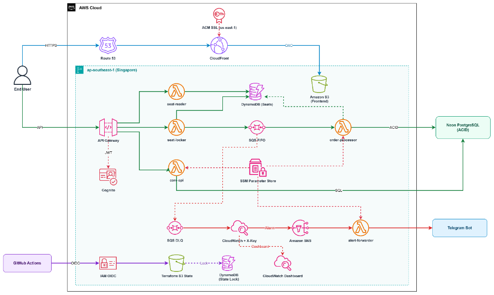
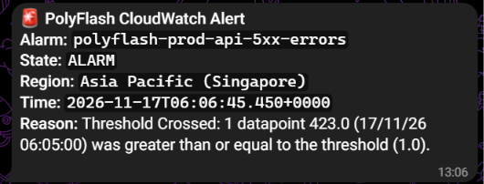
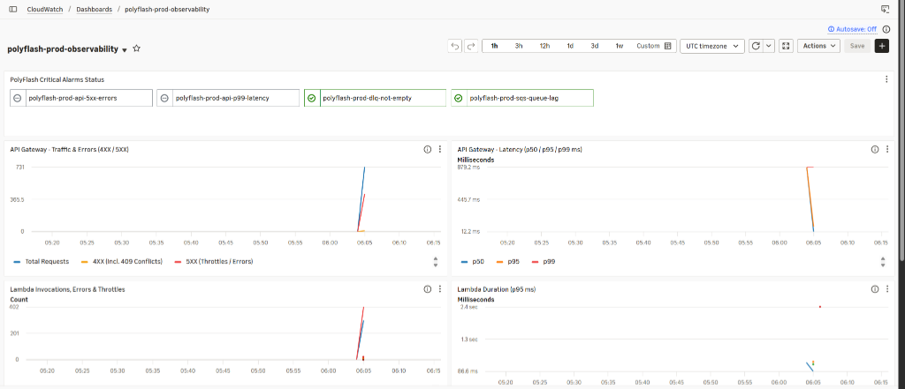

# PolyFlash — Hệ thống Đặt vé Sự kiện & Flash Sale (Dual-Core NoSQL + SQL)

**PolyFlash** là nền tảng đặt vé sự kiện trực tuyến chịu tải cao, được thiết kế theo kiến trúc **Cloud-Native**, **Serverless**, **Event-Driven** trên **AWS (`ap-southeast-1`)** kết hợp với **Neon Serverless PostgreSQL**.

Hệ thống giải quyết bài toán tranh chấp dữ liệu khắc nghiệt nhất trong các đợt mở bán vé **Flash Sale** bằng mô hình **Polyglot Persistence (Dual-Core NoSQL + SQL)**:
- **Amazon DynamoDB (NoSQL):** Phục vụ đọc sơ đồ ghế tốc độ mili-giây và khóa ghế nguyên tử (`Conditional Write` + `TTL 300s`) để chống bán trùng vé (*Zero Overselling*).
- **Neon Serverless PostgreSQL (SQL):** Lưu trữ dữ liệu tài chính, đơn hàng, vé và thanh toán chuẩn **ACID Transaction** thông qua **PgBouncer Connection Pooler**.
- **Amazon SQS FIFO + DLQ:** Bộ đệm hấp thụ các đợt truy cập đột biến (*Traffic Spike*), đảm bảo xử lý tuần tự và bảo vệ SQL Database khỏi quá tải kết nối.

---

## Mục lục
1. [Bài toán đặt ra (Problem Statement)](#1-bài-toán-đặt-ra-problem-statement)
2. [Công nghệ sử dụng (Tech Stack)](#2-công-nghệ-sử-dụng-tech-stack)
3. [Kiến trúc Cloud (Cloud Architecture)](#3-kiến-trúc-cloud-cloud-architecture)
4. [Luồng hoạt động (End-to-End Workflows)](#4-luồng-hoạt-động-end-to-end-workflows)
5. [Bảo mật hệ thống (Security Architecture)](#5-bảo-mật-hệ-thống-security-architecture)
6. [Chi phí vận hành (Cost Estimation & FinOps)](#6-chi-phí-vận-hành-cost-estimation--finops)
7. [Bảo trì & Giám sát (Maintenance & Observability)](#7-bảo-trì--giám-sát-maintenance--observability)
8. [Cấu hình OIDC, Access Key, Secrets & Variables](#8-cấu-hình-oidc-access-key-secrets--variables)
9. [Cấu hình Terraform gồm những gì?](#9-cấu-hình-terraform-gồm-những-gì)
10. [Luồng hoạt động CI/CD End-to-End](#10-luồng-hoạt-động-cicd-end-to-end)
11. [Kết quả Load Test thực tế & Năng lực chịu tải](#11-kết-quả-load-test-thực-tế--năng-lực-chịu-tải)
12. [Cấu trúc dự án & Triển khai nhanh](#12-cấu-trúc-dự-án--triển-khai-nhanh)

---

## 1. Bài toán đặt ra (Problem Statement)

Trong một đợt mở bán vé **Flash Sale** (concert, sự kiện thể thao), hàng chục nghìn **End User** có thể truy cập cùng một thời điểm và cùng nhấn chọn một chiếc ghế đẹp nhất (ví dụ ghế `A-01`). Nếu xây dựng theo kiến trúc truyền thống (1 Web Server nối thẳng vào 1 SQL Database), hệ thống sẽ gặp 3 vấn đề nghiêm trọng:

1. **Race Condition & Overselling (Bán trùng vé):** User A và User B cùng đọc thấy ghế `A-01` đang `AVAILABLE` tại cùng một mili-giây, cả hai cùng gửi lệnh đặt vé -> hệ thống ghi nhận cả 2 đơn hàng cho cùng 1 ghế.
2. **Database Connection Exhaustion (Cạn kiệt kết nối SQL):** SQL Database truyền thống có giới hạn số lượng connection đồng thời. Khi có *Traffic Spike*, hàng nghìn request mở connection cùng lúc khiến Database bị treo hoặc sập dây chuyền (*Cascading Failure*).
3. **Read/Write Contention (Nghẽn cổ chai đọc/ghi):** Người dùng liên tục làm mới sơ đồ ghế (**Read-heavy**) chiếm hết tài nguyên CPU/IOPS của Database, làm chậm quá trình thanh toán và xuất vé (**Write/ACID-heavy**).

**Cách PolyFlash giải quyết:**
- Tách riêng luồng **Đọc & Khóa ghế tạm thời** sang **DynamoDB** (chịu tải cực lớn, độ trễ vài mili-giây, hỗ trợ khóa nguyên tử bằng `Conditional Write`).
- Đưa yêu cầu chốt đơn vào hàng đợi **Amazon SQS FIFO** để làm phẳng lưu lượng (*Load Leveling*).
- Chỉ cho phép một lượng **Lambda Consumer** giới hạn (`reserved_concurrency`) đọc từ SQS FIFO và ghi giao dịch tài chính chuẩn **ACID** vào **Neon PostgreSQL**.

---

## 2. Công nghệ sử dụng (Tech Stack)

| Tầng (Layer) | Công nghệ / Dịch vụ | Vai trò trong hệ thống |
| :--- | :--- | :--- |
| **DNS & SSL/TLS** | **Amazon Route 53**, **AWS ACM** (`us-east-1`) | Định tuyến custom domain (`enormitpham.me`) và cấp phát/gia hạn chứng chỉ SSL/TLS miễn phí cho HTTPS. |
| **Edge CDN & Hosting** | **Amazon CloudFront**, **Amazon S3** | Phân phối giao diện tĩnh (`HTML/CSS/JS`) qua mạng lưới Edge toàn cầu với độ trễ thấp; S3 được khóa riêng tư qua **OAC**. |
| **API & Auth** | **API Gateway (HTTP API v2)**, **Amazon Cognito** | Cửa ngõ tiếp nhận API tập trung, định tuyến tới Lambda và xác thực người dùng bằng **JWT Authorizer**. |
| **Compute (Serverless)** | **AWS Lambda** (Node.js 22, TypeScript, `esbuild`) | Gồm 5 microservices độc lập: `seat-reader`, `seat-locker`, `order-processor`, `core-api`, `alert-forwarder`. |
| **NoSQL Database** | **Amazon DynamoDB** (On-Demand + TTL) | Lưu trạng thái ghế theo thời gian thực (`AVAILABLE`, `HELD`, `SOLD`) và tự động nhả ghế hết hạn bằng **TTL**. |
| **SQL Database** | **Neon Serverless PostgreSQL** + **PgBouncer** | Lưu trữ dữ liệu nghiệp vụ & tài chính (`users`, `events`, `orders`, `tickets`, `payments`) chuẩn **ACID**. |
| **Messaging** | **Amazon SQS FIFO** + **Dead Letter Queue (DLQ)** | Đảm bảo thứ tự xử lý đơn hàng theo từng ghế/sự kiện (`MessageGroupId`) và cô lập message lỗi vào DLQ. |
| **Secrets Management** | **AWS SSM Parameter Store** (`SecureString`) | Lưu trữ chuỗi kết nối Database và Telegram Bot Token được mã hóa KMS, cấp quyền đọc theo **IAM Least Privilege**. |
| **Observability & ChatOps** | **CloudWatch**, **AWS X-Ray**, **Amazon SNS**, **Telegram Bot** | Thu thập Logs, Metrics, Distributed Tracing, Dashboard tập trung và bắn cảnh báo sự cố thời gian thực về Telegram. |
| **IaC & CI/CD** | **Terraform**, **GitHub Actions**, **OIDC**, **Gitleaks**, **Checkov**, `neonctl` | Quản lý toàn bộ hạ tầng dưới dạng code (Infrastructure as Code) và tự động hóa kiểm thử, migrate DB, deploy không cần Access Key tĩnh. |

---

## 3. Kiến trúc Cloud (Cloud Architecture)



> Nếu bạn mới tiếp cận Cloud, có thể hình dung kiến trúc trên chia thành **4 vùng chính**:

1. **Global Edge Layer (Phía trên - ngoài Region):**
   - **Route 53** đóng vai trò danh bạ DNS chuyển tên miền thành địa chỉ **CloudFront CDN**.
   - **ACM SSL (`us-east-1`)** cung cấp chứng chỉ bảo mật HTTPS cho CloudFront (theo quy chuẩn của AWS, chứng chỉ gắn vào CloudFront bắt buộc đặt tại region `us-east-1`).
   - **CloudFront** lưu bản sao giao diện tại các máy chủ biên gần người dùng nhất và giao tiếp với **Amazon S3 (Frontend)** qua cơ chế **OAC (Origin Access Control)** — tức là người dùng không bao giờ truy cập trực tiếp được vào S3 bucket.

2. **Regional Core (`ap-southeast-1` Singapore):**
   - **API Gateway** là cổng tiếp nhận toàn bộ API request từ trình duyệt. Với các API cần đăng nhập (như giữ ghế, thanh toán, xem vé), API Gateway kiểm tra chữ ký **JWT** với **Amazon Cognito** trước khi cho phép đi tiếp.
   - 3 Lambda xử lý API đồng bộ:
     - `seat-reader`: Đọc danh sách ghế từ **DynamoDB**.
     - `seat-locker`: Khóa ghế trên **DynamoDB** và đẩy tin nhắn vào **SQS FIFO**.
     - `core-api`: Xử lý các API CRUD khác (danh sách sự kiện, hồ sơ user, thanh toán, lịch sử đơn hàng, trang Admin) và đọc/ghi trực tiếp vào **Neon PostgreSQL**.

3. **Async Processing & External SQL (`SQS FIFO` -> `Neon PostgreSQL`):**
   - **SQS FIFO** đóng vai trò vùng đệm. **Lambda `order-processor`** tự động kéo tin nhắn từ SQS FIFO theo từng lô nhỏ để ghi đơn hàng vào **Neon PostgreSQL (ACID)**, sau đó cập nhật ngược lại trạng thái ghế sang `SOLD` trên **DynamoDB**.
   - Các thông số nhạy cảm như `DATABASE_URL` và `TELEGRAM_BOT_TOKEN` được lưu trong **SSM Parameter Store**; các Lambda chỉ được cấp quyền đọc (*read-only*) khi thực thi.

4. **Monitoring & CI/CD Foundation (Phía dưới):**
   - Nếu `SQS FIFO` xử lý thất bại nhiều lần, tin nhắn rơi vào **SQS DLQ**. **CloudWatch + X-Ray** phát hiện lỗi/độ trễ vượt ngưỡng -> kích hoạt **Alarm** đẩy qua **Amazon SNS** -> gọi Lambda `alert-forwarder` gửi cảnh báo về **Telegram Bot**, đồng thời hiển thị toàn bộ chỉ số lên **CloudWatch Dashboard**.
   - Ở góc dưới trái, **GitHub Actions** xác thực với AWS bằng **IAM OIDC** (không dùng mật khẩu/Access Key tĩnh) để triển khai hạ tầng **Terraform**, lưu trạng thái tại **Terraform S3 State** và khóa chống xung đột bằng **DynamoDB (State Lock)**.

---

## 4. Luồng hoạt động (End-to-End Workflows)

### 4.1. Luồng tải giao diện & xác thực (`Frontend + Cognito`)
1. End User truy cập `https://enormitpham.me` -> **Route 53** trỏ về **CloudFront**.
2. Nếu Edge Cache chưa có dữ liệu, CloudFront dùng **OAC** lấy file tĩnh (`index.html`, `seats.html`, `common.js`,...) từ **Amazon S3** và cache lại.
3. Khi người dùng đăng ký/đăng nhập tại `auth.html`, trình duyệt giao tiếp với **Amazon Cognito User Pool** để nhận **ID Token / Access Token (JWT)**.

### 4.2. Luồng đọc sơ đồ ghế (`Read Path — Zero SQL Load`)
1. Trang `seats.html` gọi `GET /api/v1/events/{id}/seats` tới **API Gateway** (không cần token đăng nhập để xem).
2. API Gateway kích hoạt Lambda `seat-reader`.
3. `seat-reader` thực hiện lệnh `Query` trên bảng **DynamoDB** (`PK = EVENT#<event_id>`) và trả về trạng thái từng ghế trong vài chục mili-giây mà **không chạm vào Neon PostgreSQL**.

### 4.3. Luồng giữ ghế & chốt đơn Flash Sale (`Write Path — Anti-Overselling`)
1. Người dùng chọn ghế (ví dụ `A-01`) và bấm giữ ghế -> gửi `POST /api/v1/events/{id}/seats/{seatId}/hold` kèm header `Authorization: Bearer <JWT>`.
2. **API Gateway** xác thực JWT hợp lệ qua **Cognito Authorizer**, trích xuất `sub` (User ID) vào request context rồi gọi Lambda `seat-locker`.
3. `seat-locker` thực hiện **DynamoDB Conditional Write (`UpdateItem`)**:
   - Điều kiện bắt buộc: `status = 'AVAILABLE'` **HOẶC** (`status = 'HELD'` nhưng `ttl < now()`).
   - Nếu 30 người bấm cùng lúc: chỉ **1 người duy nhất** thỏa điều kiện và ghi thành công (`status = 'HELD'`, `held_by = userId`, `ttl = now + 300s`).
   - 29 người còn lại nhận ngay lỗi `ConditionalCheckFailedException` -> API trả về `409 Conflict` ("Ghế đã có người giữ").
4. Với người giữ thành công, `seat-locker` đẩy message chứa thông tin giữ ghế vào **Amazon SQS FIFO** (`MessageGroupId = "<eventId>#<seatId>"`) và trả về ngay HTTP `202 Accepted` cho client.
5. Lambda `order-processor` (được giới hạn `maximum_concurrency = 15`) nhận message từ SQS FIFO -> đọc `NEON_DATABASE_POOLED_URL` từ **SSM Parameter Store** -> mở **ACID Transaction** (`BEGIN ... COMMIT`) tạo bản ghi trong `orders` và `tickets` trên **Neon PostgreSQL**.
6. Sau khi SQL commit thành công, `order-processor` cập nhật ghế trên **DynamoDB** từ `HELD` sang `SOLD` và xóa thuộc tính `ttl` để ghế không bị tự động nhả.

### 4.4. Luồng tự động nhả ghế hết hạn (`Auto-Release TTL`)
- Nếu người dùng giữ ghế nhưng không thanh toán trong **300 giây (5 phút)**, giá trị `ttl` trên DynamoDB sẽ hết hạn.
- Khi có người khác bấm chọn ghế đó (`ttl < now()`), điều kiện `Conditional Write` của `seat-locker` tự động cho phép người mới chiếm quyền giữ ghế ngay lập tức mà không cần chạy Cron Job dọn dẹp thủ công; đồng thời cơ chế **DynamoDB TTL** sẽ tự động thu hồi trạng thái hết hạn ở tầng nền.

### 4.5. Luồng cảnh báo sự cố (`Observability -> ChatOps`)
- Khi có message lỗi bị đẩy sang **SQS DLQ**, độ trễ p99 vượt ngưỡng hoặc API phát sinh HTTP `5xx`:
  1. **CloudWatch Alarm** chuyển sang trạng thái `ALARM`.
  2. Alarm bắn sự kiện tới **Amazon SNS Topic**.
  3. SNS kích hoạt Lambda `alert-forwarder`.
  4. `alert-forwarder` đọc `telegram_bot_token` và `telegram_chat_id` từ **SSM Parameter Store**, định dạng nội dung sự cố và gửi thẳng vào nhóm **Telegram** của đội vận hành.

---

## 5. Bảo mật hệ thống (Security Architecture)

PolyFlash áp dụng tư duy **Defense-in-Depth (Bảo mật đa lớp)**:

1. **Không dùng AWS Access Key tĩnh trong CI/CD (Keyless via OIDC):**
   - GitHub Actions xác thực với AWS thông qua **OIDC Federation**. Token tạm thời chỉ có hiệu lực tối đa 1 giờ (`max_session_duration = 3600s`) và bị khóa chặt bởi IAM Trust Policy: chỉ đúng repo `Enormit/dualcore-nosql-sql-ticketing`, nhánh `main` (hoặc `environment: production`) mới được quyền `sts:AssumeRoleWithWebIdentity`.
2. **S3 Private Origin với CloudFront OAC:**
   - `aws_s3_bucket_public_access_block` bật toàn bộ 4 cờ chặn truy cập công khai (`block_public_acls`, `block_public_policy`, `ignore_public_acls`, `restrict_public_buckets`).
   - Bucket Policy chỉ cho phép Service Principal `cloudfront.amazonaws.com` thực hiện `s3:GetObject` khi khớp `AWS:SourceArn` của CloudFront Distribution.
3. **Xác thực & Phân quyền API với Cognito JWT:**
   - Mọi API thay đổi dữ liệu đều đi qua `aws_apigatewayv2_authorizer.cognito_jwt`.
   - Backend không bao giờ tin `userId` gửi trong JSON body mà lấy trực tiếp từ JWT Claims đã được API Gateway xác minh chữ ký.
4. **Quản lý Secrets tập trung với SSM Parameter Store:**
   - Toàn bộ chuỗi kết nối **Neon DB** và **Telegram Token** lưu dạng `SecureString` (mã hóa bằng AWS KMS). Không hardcode secret trong code hay biến môi trường plaintext của Terraform state (ngoại trừ giá trị truyền vào từ CI/CD secrets).
5. **IAM Least Privilege (Quyền tối thiểu):**
   - Mỗi Lambda có một IAM Role riêng biệt trong `infra/modules/compute/main.tf`:
     - `seat-reader`: chỉ có `dynamodb:Query`, `dynamodb:GetItem` (không có quyền ghi/xóa).
     - `seat-locker`: chỉ có `dynamodb:GetItem`, `dynamodb:UpdateItem` và `sqs:SendMessage`.
     - `order-processor`: chỉ có quyền đọc SQS FIFO, cập nhật DynamoDB và đọc đúng key `neon_pooled_url` trong SSM.
     - `alert-forwarder`: chỉ được đọc đúng 2 key Telegram trong SSM.
6. **Bảo mật mã nguồn & IaC tự động (Shift-Left Security):**
   - Mỗi Pull Request đều bị quét bởi **Gitleaks** (phát hiện lộ API key/password trong git commit) và **Checkov** (kiểm tra lỗi bảo mật cấu hình Terraform).

---

## 6. Chi phí vận hành (Cost Estimation & FinOps)

Vì toàn bộ hệ thống dùng kiến trúc **Serverless Pay-as-you-go**, khi không có người dùng truy cập, chi phí tính toán gần như bằng **\$0/tháng** (trừ phí duy trì tên miền/Hosted Zone).

| Dịch vụ | Cơ chế tính phí | AWS Free Tier | Ước tính chi phí thực tế (MVP / Production vừa) |
| :--- | :--- | :--- | :--- |
| **AWS Lambda** | Theo số lượt gọi & GB-giây | 1 triệu requests + 400,000 GB-s/tháng (vĩnh viễn) | **\$0** ở mức dưới 1M requests/tháng |
| **API Gateway (HTTP API v2)** | ~\$1.00 / 1 triệu requests | 1 triệu API calls/tháng (12 tháng đầu) | **\$0 – \$1.00 / tháng** |
| **Amazon DynamoDB** | `PAY_PER_REQUEST` (On-Demand) | 25 GB storage + 25 WCU/RCU | **\$0 – \$1.50 / tháng** |
| **Amazon S3 + CloudFront** | Dung lượng lưu trữ & băng thông Out | 1 TB data transfer out + 10M HTTP requests/tháng (CloudFront Free Tier vĩnh viễn) | **\$0** (dưới 1 TB/tháng) |
| **Amazon SQS FIFO + SNS** | Theo số lượng request | 1 triệu SQS requests/tháng (vĩnh viễn) | **\$0** |
| **Amazon Cognito** | Theo MAU (Monthly Active Users) | 50,000 MAUs miễn phí (Cognito Essentials/Lite tier) | **\$0** |
| **CloudWatch & X-Ray** | Logs ingestion (14 ngày), Metrics, Dashboard, Alarms | 5 GB logs + 10 Alarms + 3 Dashboards + 100k X-Ray traces/tháng | **\$0** (giới hạn `log_retention_days = 14` để tránh phình phí lưu trữ log) |
| **Neon PostgreSQL** | Compute hours & Storage (Scale-to-zero khi rỗi) | Free Tier (0.5 GB storage, 191.9 compute hours/tháng) | **\$0** (Free Tier) hoặc ~\$19/tháng (Launch Plan) |
| **Amazon Route 53** | Hosted Zone cố định | Không thuộc Free Tier | **\$0.50 / tháng** cho 1 Hosted Zone |

> **Tổng chi phí vận hành thực tế:** Khoảng **\$0.50 – \$3.00 / tháng** cho môi trường demo/production nhỏ, và tự động co giãn tuyến tính theo doanh thu khi bán vé lớn.

---

## 7. Bảo trì & Giám sát (Maintenance & Observability)

Hệ thống được giám sát tập trung trong module `infra/modules/monitoring/main.tf` để phát hiện sớm mọi bất thường trước khi người dùng phàn nàn:

### 7.1. Bốn (04) CloudWatch Alarms cốt lõi
1. **`dlq_not_empty` (`ApproximateNumberOfMessagesVisible > 0`):** Báo động ngay lập tức khi có đơn hàng xử lý thất bại rơi vào **SQS DLQ**.
2. **`sqs_oldest_message_age` (`ApproximateAgeOfOldestMessage > 60s`):** Cảnh báo khi hàng đợi **SQS FIFO** bị ùn tắc quá 1 phút (dấu hiệu Neon DB chậm hoặc `order-processor` bị nghẽn).
3. **`api_5xx_errors` (`5xx > 0`):** Cảnh báo ngay khi **API Gateway** phát sinh lỗi hệ thống `500/502/503`.
4. **`api_p99_latency` (`Latency p99 > 2000ms`):** Cảnh báo khi 1% request chậm nhất vượt quá 2 giây.

### 7.2. CloudWatch Dashboard & AWS X-Ray
- **Dashboard `polyflash-prod-observability`:** Tổng hợp trạng thái 4 Alarms, biểu đồ Request / 4XX / 5XX của API Gateway, độ trễ `p50 / p95 / p99`, số lần gọi và thời gian chạy của từng Lambda, độ sâu hàng đợi SQS và số lượng Throttled Events trên DynamoDB.
- **AWS X-Ray (`aws_xray_sampling_rule`):** Theo dõi dấu vết phân tán (*Distributed Tracing*) từ API Gateway -> Lambda -> DynamoDB / SQS để định vị chính xác hàm nào gây chậm.

### 7.3. Minh họa vận hành thực tế trên AWS
*Cảnh báo CloudWatch tự động bắn qua SNS -> `alert-forwarder` về Telegram khi có 423 lỗi `503` trong bài test tải:*



*Giao diện CloudWatch Observability Dashboard thực tế:*



### 7.4. Quy trình bảo trì định kỳ
- **Xử lý khi có tin nhắn trong SQS DLQ:** Kiểm tra log lỗi của `order-processor` trên CloudWatch Logs -> khắc phục nguyên nhân (ví dụ schema DB hoặc connection) -> dùng tính năng **SQS DLQ Redrive** trên AWS Console để đẩy message quay lại `order-queue.fifo` xử lý bù.
- **Xoay vòng Secrets (Secret Rotation):** Khi đổi mật khẩu Neon DB hoặc Telegram Bot Token, cập nhật Secret trên GitHub Environment `production` và chạy workflow `infra-deploy.yml` (hoặc cập nhật trực tiếp SSM Parameter Store).
- **Quản lý Log Retention:** Toàn bộ CloudWatch Log Groups của API Gateway và 5 Lambda đều được đặt `retention_in_days = 14` để tự động xóa log cũ, tối ưu chi phí.

---

## 8. Cấu hình OIDC, Access Key, Secrets & Variables

### 8.1. Hiểu đúng về Access Key vs. IAM OIDC
- **AWS Access Key (`AWS_ACCESS_KEY_ID` / `AWS_SECRET_ACCESS_KEY`):** Là cặp khóa dài hạn gắn với một IAM User. **Chỉ dùng ở máy cá nhân (Local)** khi kỹ sư cần chạy `terraform init` / `terraform apply` lần đầu để bootstrap hệ thống, hoặc debug cục bộ qua AWS CLI. **Tuyệt đối không** đưa Access Key lên GitHub Secrets vì nếu lộ sẽ có nguy cơ bị chiếm quyền lâu dài.
- **IAM OIDC (OpenID Connect):** Là cơ chế tin cậy trực tiếp giữa **GitHub Actions** và **AWS IAM**. Mỗi lần workflow chạy, GitHub cấp cho runner một JWT ngắn hạn; runner gửi JWT đó cho AWS STS (`sts:AssumeRoleWithWebIdentity`) để đổi lấy cặp credentials tạm thời tự hủy sau 1 giờ.

### 8.2. Cách cấu hình AWS IAM OIDC cho GitHub Actions (đã tự động hóa bằng Terraform)
Trong `infra/modules/cicd/main.tf`, Terraform tự động tạo 3 thành phần:
1. **OIDC Identity Provider:**
   - URL: `https://token.actions.githubusercontent.com`
   - Audience (`client_id_list`): `["sts.amazonaws.com"]`
2. **Deploy Role (`polyflash-prod-github-deploy-role`):**
   - Dùng cho `infra-deploy.yml` và `app-deploy.yml`.
   - Điều kiện Trust Policy (`sub`): Chỉ cho phép khi chạy từ đúng repository `Enormit/dualcore-nosql-sql-ticketing` trên nhánh `refs/heads/main` hoặc `environment:production`.
3. **PR Verification Role (`polyflash-prod-github-pr-plan-role`):**
   - Dùng cho `pr-verification.yml`.
   - Gắn policy **ReadOnly** để kiểm tra Pull Request, không có quyền sửa/xóa tài nguyên AWS.

### 8.3. Danh sách Secrets & Variables trên GitHub Environment (`production`)

| Loại | Tên biến | Nguồn lấy / Mục đích |
| :--- | :--- | :--- |
| **Secret** | `AWS_OIDC_DEPLOY_ROLE_ARN` | Lấy từ `terraform output -raw github_oidc_deploy_role_arn` |
| **Secret** | `AWS_OIDC_PR_ROLE_ARN` | Lấy từ `terraform output -raw github_oidc_pr_plan_role_arn` |
| **Secret** | `NEON_DATABASE_POOLED_URL` | Chuỗi kết nối PgBouncer của Neon PostgreSQL (cho Runtime Lambda) |
| **Secret** | `NEON_DATABASE_DIRECT_URL` | Chuỗi kết nối Direct của Neon PostgreSQL (cho `npm run migrate`) |
| **Secret** | `NEON_API_KEY` | API Key của Neon để tạo/xóa Ephemeral DB Branch khi mở/đóng PR |
| **Secret** | `TELEGRAM_BOT_TOKEN` | Token của Telegram Bot nhận cảnh báo |
| **Secret** | `TELEGRAM_CHAT_ID` | ID nhóm/kênh Telegram nhận cảnh báo |
| **Variable** | `AWS_REGION` | `ap-southeast-1` |
| **Variable** | `FRONTEND_S3_BUCKET` | Tên S3 bucket từ `terraform output -raw frontend_s3_bucket` |
| **Variable** | `CLOUDFRONT_DISTRIBUTION_ID` | ID CloudFront Distribution để tạo Invalidation sau khi deploy frontend |
| **Variable** | `API_ENDPOINT` | URL API Gateway từ `terraform output -raw api_endpoint` |
| **Variable** | `NEON_PROJECT_ID` | ID Project trên Neon để `neonctl` tạo nhánh DB tạm |

### 8.4. Đồng bộ tự động bằng script `scripts/sync-github-env.sh`
Thay vì nhập tay từng secret trên giao diện web GitHub, dự án cung cấp script [scripts/sync-github-env.sh](file:///home/ubuntu/dualcore-nosql-sql-ticketing/scripts/sync-github-env.sh). Script này đọc `.env` + `terraform -chdir=infra output -json`, dùng `libsodium-wrappers` mã hóa secret theo chuẩn **NaCl SealedBox** của GitHub rồi đẩy toàn bộ lên Environment `production` thông qua GitHub REST API:

```bash
GH_TOKEN="github_pat_xxx" ./scripts/sync-github-env.sh
```

---

## 9. Cấu hình Terraform gồm những gì?

Toàn bộ hạ tầng được viết theo mô hình **Modular Terraform** nằm trong thư mục `infra/`.

### 9.1. Remote State Backend & Providers (`infra/providers.tf`)
- **Remote State trên S3 + DynamoDB Lock:**
  - `bucket = "polyflash-terraform-state-755272426779"`, `key = "prod/terraform.tfstate"`, `encrypt = true`: Lưu file trạng thái hạ tầng tập trung trên S3 và mã hóa toàn bộ.
  - `dynamodb_table = "polyflash-terraform-locks"`: Cơ chế **State Lock** ngăn chặn 2 người (hoặc 2 pipeline CI/CD) chạy `terraform apply` cùng lúc làm hỏng file state.
- **Dual AWS Providers:**
  - Provider mặc định: `ap-southeast-1` (Singapore) cho toàn bộ compute, database, API.
  - Provider alias `aws.us_east_1`: `us-east-1` (N. Virginia) — **bắt buộc** để tạo chứng chỉ **ACM SSL** gắn vào **CloudFront**.

### 9.2. Chi tiết 8 Terraform Modules (`infra/modules/`)

| Module | Đường dẫn | Tài nguyên AWS được khởi tạo |
| :--- | :--- | :--- |
| **storage** | `infra/modules/storage/main.tf` | Bảng DynamoDB `event_seats` (Pay-per-request, bật TTL) và 4 tham số SSM Parameter Store `SecureString` (`neon_pooled_url`, `neon_direct_url`, `telegram_bot_token`, `telegram_chat_id`). |
| **messaging** | `infra/modules/messaging/main.tf` | Hàng đợi `order_queue.fifo` (`content_based_deduplication`) và `order_dlq.fifo` (Redrive policy khi lỗi quá số lần thử). |
| **auth** | `infra/modules/auth/main.tf` | `aws_cognito_user_pool` và `aws_cognito_user_pool_client` phục vụ đăng ký, đăng nhập và phát hành JWT. |
| **frontend** | `infra/modules/frontend/main.tf` | `aws_s3_bucket` (chặn Public Access), `aws_cloudfront_origin_access_control` (OAC), `aws_acm_certificate` + DNS validation trên Route 53, `aws_cloudfront_distribution` và bản ghi `A`/`AAAA` trên Route 53. |
| **compute** | `infra/modules/compute/main.tf` | 5 IAM Roles tách quyền riêng cho 5 Lambda (`seat-reader`, `seat-locker`, `order-processor`, `core-api`, `alert-forwarder`), 5 `aws_lambda_function` (Node.js 22 + X-Ray Active Tracing), `aws_lambda_event_source_mapping` nối SQS FIFO vào `order-processor` và CloudWatch Log Groups (14 ngày). |
| **api** | `infra/modules/api/main.tf` | `aws_apigatewayv2_api` (HTTP API v2), `cognito_jwt` authorizer, các routes (`GET /seats`, `POST /hold`, `$default` tới `core-api`), Stage logs và Lambda Invoke Permissions. |
| **monitoring** | `infra/modules/monitoring/main.tf` | `aws_sns_topic` (`alerts`), SNS Lambda subscription tới `alert-forwarder`, 4 `aws_cloudwatch_metric_alarm`, `aws_xray_sampling_rule` và `aws_cloudwatch_dashboard` (`polyflash-prod-observability`). |
| **cicd** | `infra/modules/cicd/main.tf` | `aws_iam_openid_connect_provider` (GitHub OIDC), `github_deploy` role và `github_pr_plan` read-only role. |

### 9.3. Các biến cấu hình chính (`infra/variables.tf`)
- `aws_region` (`ap-southeast-1`), `project_name` (`polyflash`), `environment` (`prod`)
- `seat_hold_ttl_seconds` (`300` giây = 5 phút)
- `order_processor_reserved_concurrency` (`15` — giới hạn số Lambda đồng thời ghi vào Neon DB)
- `log_retention_days` (`14` ngày)
- `github_owner`, `github_repo`, `github_deploy_branch` (`main`), `create_github_oidc_provider`
- `custom_domain_name` (`enormitpham.me`)

---

## 10. Luồng hoạt động CI/CD End-to-End

Hệ thống CI/CD được vận hành qua **3 GitHub Actions Workflows** trong `.github/workflows/`:

```text
[Developer mở PR vào main]
   └──▶ pr-verification.yml
           ├── Gitleaks (quét secrets) + Checkov (quét Terraform security)
           ├── Build TypeScript & chạy Unit Mock Tests cho Lambda
           ├── Tạo Ephemeral Neon DB Branch (pr-<số_PR>) & test chạy SQL Migration
           └── Xác thực OIDC Read-Only -> terraform fmt / init / validate
           (Khi PR đóng: tự động xóa Ephemeral Neon DB Branch)

[Merge vào nhánh main]
   ├── Nếu có thay đổi trong infra/** ──▶ infra-deploy.yml
   │       ├── Bundle 5 Lambdas bằng esbuild
   │       ├── Xác thực AWS qua OIDC Deploy Role
   │       └── terraform init (S3 + DynamoDB Lock) -> validate -> terraform apply
   │
   └── Nếu có thay đổi trong services/**, db/**, frontend/** ──▶ app-deploy.yml
           ├── Chạy SQL Migration lên Neon PostgreSQL (Direct URL)
           ├── Test, Build TypeScript, Bundle esbuild & nén function.zip
           ├── Xác thực AWS qua OIDC Deploy Role
           ├── aws lambda update-function-code (cập nhật 5 Lambdas)
           ├── aws s3 sync frontend/ + CloudFront Cache Invalidation (/*)
           └── Post-Deploy Smoke Test (curl kiểm tra API /events & /seats)
```

### Chi tiết từng Workflow:
1. **[pr-verification.yml](file:///home/ubuntu/dualcore-nosql-sql-ticketing/.github/workflows/pr-verification.yml):** Chạy mỗi khi tạo hoặc cập nhật Pull Request nhắm vào `main`. Điểm nổi bật là tạo một **nhánh Database tạm thời trên Neon (`pr-<number>`)** bằng `neonctl` để thử nghiệm file migration SQL mới mà hoàn toàn không ảnh hưởng Production DB; khi PR được merge hoặc close, nhánh DB tạm này tự động bị xóa.
2. **[infra-deploy.yml](file:///home/ubuntu/dualcore-nosql-sql-ticketing/.github/workflows/infra-deploy.yml):** Chỉ kích hoạt khi thư mục `infra/` thay đổi. Dùng `concurrency` group `polyflash-infra-prod` (`cancel-in-progress: false`) để đảm bảo các lần deploy hạ tầng xếp hàng tuần tự, không bao giờ hủy ngang giữa chừng khi đang `terraform apply`.
3. **[app-deploy.yml](file:///home/ubuntu/dualcore-nosql-sql-ticketing/.github/workflows/app-deploy.yml):** Triển khai ứng dụng End-to-End: Migrate SQL -> Test & Bundle 5 Lambda bằng `esbuild` -> Cập nhật code Lambda -> Đồng bộ Frontend lên S3 -> Xóa cache CloudFront (`/*`) -> Gọi `curl` kiểm tra API sống ngay sau khi deploy (**Post-Deploy Smoke Test**).

---

## 11. Kết quả Load Test thực tế & Năng lực chịu tải

Kịch bản giả tải [tests/load-test/flash-sale-bench.mjs](file:///home/ubuntu/dualcore-nosql-sql-ticketing/tests/load-test/flash-sale-bench.mjs) được bắn trực tiếp tới các endpoint AWS Production (`CloudFront` và `API Gateway` tại Singapore):

```bash
AUTH_TOKEN="<cognito_id_token>" node tests/load-test/flash-sale-bench.mjs
```

### 11.1. Hiệu năng phân phối Frontend tĩnh (`CloudFront + S3`)
| Mức đồng thời (Concurrency) | Tổng Request | Throughput (RPS) | HTTP `200` | p50 Latency | p95 Latency | p99 Latency |
| :---: | :---: | :---: | :---: | :---: | :---: | :---: |
| **50** | 300 | **280 req/s** | 300 / 300 (100%) | 86.20 ms | 591.85 ms | 733.68 ms |
| **150** | 600 | **297 req/s** | 600 / 600 (100%) | 95.89 ms | 1,269.44 ms | 1,637.12 ms |

### 11.2. Hiệu năng đọc sơ đồ ghế (`API Gateway -> seat-reader -> DynamoDB`)
| Mức đồng thời (Concurrency) | Tổng Request | Throughput (RPS) | HTTP `200` | HTTP `503` (Throttled) | p50 Latency | p95 Latency | p99 Latency |
| :---: | :---: | :---: | :---: | :---: | :---: | :---: | :---: |
| **10** | 100 | **52 req/s** | 100 (100%) | 0 | 91.38 ms | 862.33 ms | 1,195.14 ms |
| **30** | 300 | 299 req/s | 135 | 165 | 69.76 ms | 290.36 ms | 412.17 ms |
| **60** | 300 | 377 req/s | 63 | 237 | 64.76 ms | 508.13 ms | 628.59 ms |

> **Phát hiện nút thắt (Bottleneck) từ bài test thực tế:** Tài khoản AWS đang test bị giới hạn **Account Unreserved Lambda Concurrency = 10**. Vì vậy ở mức concurrency `10`, hệ thống đạt **100% thành công (`52 RPS`)**; khi đẩy lên `30`–`60` đồng thời, các request vượt quá 10 Lambda song song bị AWS Lambda trả về `503 Service Unavailable`.

### 11.3. Kiểm thử tranh chấp Flash Sale (`30 users` đồng thời tranh 1 ghế `A-01` có Cognito JWT thật)
Luồng đầy đủ: `API Gateway (JWT Authorizer) -> seat-locker -> DynamoDB Conditional Write -> SQS FIFO -> order-processor -> Neon PostgreSQL`

| Số User đồng thời | Giữ ghế thành công (`202`) | Bị từ chối (`409 Conflict`) | Bị giới hạn Lambda (`503`) | Bán trùng vé (Overselling) | p50 Latency | p99 Latency |
| :---: | :---: | :---: | :---: | :---: | :---: | :---: |
| **30** | **1** (`cloud-load-user-19`) | **8** | **21** | **0** | 113.88 ms | 980.74 ms |

**Xác minh dữ liệu End-to-End sau bài test:**
- **Neon PostgreSQL (`orders` & `tickets`):** Ghi nhận đúng 1 đơn hàng `COMPLETED` (`bfdc9763-4ffa-4524-80ea-689d3187fe00`, `user_id = cloud-load-user-19`, `seat_id = A-01`, `1,200,000đ`).
- **Amazon DynamoDB (`polyflash-prod-event-seats`):** Ghế `A-01` tự động đồng bộ sang trạng thái `SOLD` và gỡ bỏ TTL.

### 11.4. Ước tính năng lực chịu tải trên Production chuẩn (Lambda Quota = `1,000` Concurrent Executions)
| Tầng hệ thống | Cấu hình Production | Năng lực xử lý ước tính | Số Concurrent Users ước tính |
| :--- | :--- | :--- | :--- |
| **Frontend (`S3 + CloudFront`)** | Edge Caching toàn cầu | Không giới hạn thực tế | **> 100,000+ users** |
| **Đọc sơ đồ ghế (`seat-reader` + DynamoDB)** | `1,000` Concurrent Lambdas (~190ms/req) | **~5,200 RPS** | **~13,000 users** polling mỗi `2.5s` |
| **Giữ chỗ (`seat-locker` + SQS FIFO)** | SQS FIFO (`300 TPS` chuẩn / `3,000 TPS` batch) | **300 – 3,000 lượt giữ/giây** | Chống trùng tuyệt đối **0% overselling** |
| **Chốt đơn ACID (`order-processor` + Neon DB)** | `maximum_concurrency = 15`, `batch_size = 10` | **~150 – 300 đơn/giây** | SQS FIFO đệm burst, không sập SQL |

---

## 12. Cấu trúc dự án & Triển khai nhanh

```text
dualcore-nosql-sql-ticketing/
├── .github/workflows/      # 3 CI/CD pipelines (pr-verification, infra-deploy, app-deploy)
├── db/                     # SQL migrations (Neon Direct URL), seed data & DynamoDB schema
├── docs/                   # Kiến trúc (architecture.png), đặc tả API (api-spec.md) & minh chứng vận hành
├── frontend/               # Giao diện đa trang (Lobby, Seat Map, Checkout, Tickets, Admin, Auth)
├── infra/                  # Modular Terraform IaC (8 modules + Remote S3 State & DynamoDB Lock)
├── scripts/                # local-server.mjs & sync-github-env.sh
├── services/               # 5 AWS Lambda microservices (TypeScript + esbuild)
└── tests/load-test/        # Kịch bản giả tải & kiểm thử tranh chấp Flash Sale trên AWS Cloud
```

### Triển khai thủ công từ máy Local
```bash
# 1. Bundle 5 AWS Lambda microservices
for svc in seat-reader seat-locker order-processor alert-forwarder core-api; do
  npm ci --prefix "services/$svc"
  npx --yes esbuild "services/$svc/src/index.ts" --bundle --platform=node --target=node22 --format=cjs --outfile="services/$svc/bundle/index.js"
done

# 2. Khởi tạo & triển khai hạ tầng Terraform
cd infra
terraform init
terraform apply

# 3. Chạy SQL Migration, Seed dữ liệu & Unit Mock Tests
cd ..
npm run migrate --prefix db
npm run seed --prefix db

for svc in seat-reader seat-locker order-processor; do
  npm test --prefix "services/$svc"
done
```
